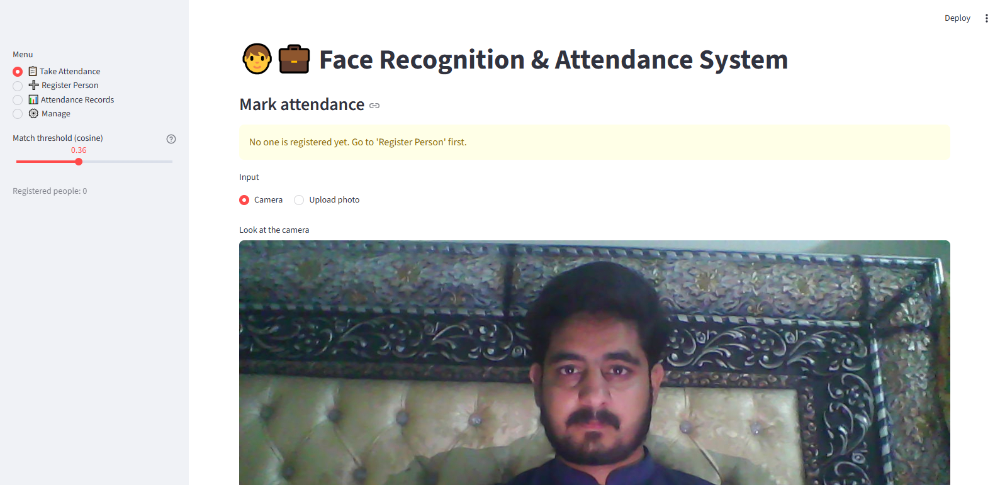
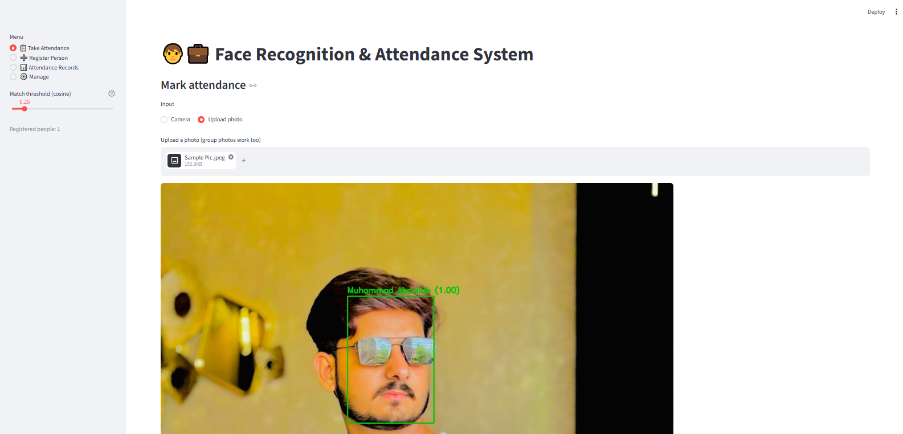
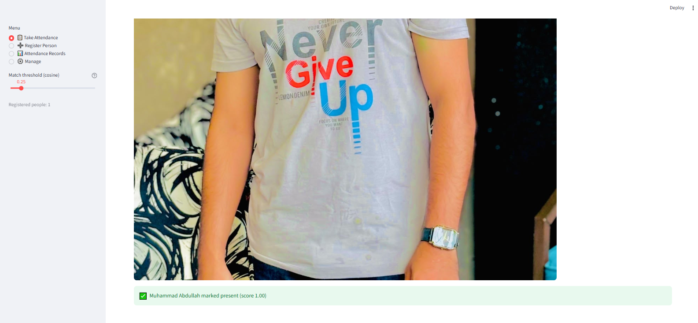
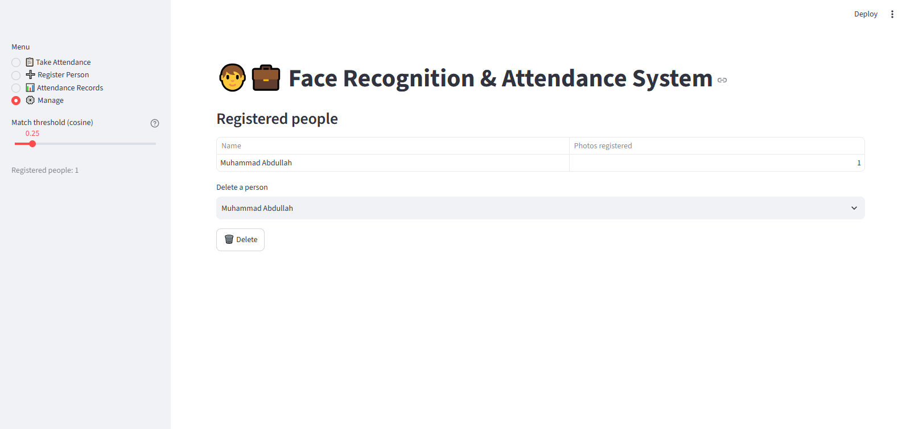

# 🧑‍💼 Face Recognition & Attendance System

[](https://colab.research.google.com/github/MuhammadAbdullahIkram/Face-Recognition-Attendance-System/blob/main/Face_Recognition_Attendance.ipynb)


An AI-based attendance system that **detects faces, recognises registered people and automatically marks attendance** (one entry per person per day) with date and time. It comes with a **Google Colab notebook** for experimenting and a **Streamlit web app** for day-to-day use.

---

## ✨ Features

- Face **detection** with YuNet and face **recognition** with SFace (128-d embeddings + cosine similarity)
- Works with **webcam, uploaded photos, and group photos**
- **Register** new people from the UI (or from a folder of images)
- Automatic attendance marking - **no duplicates** in a day
- Attendance dashboard: date filter, summary metrics, bar chart, **CSV download**
- Adjustable match threshold, delete registered people
- Optional **real-time webcam** mode for a local PC
- Lightweight: **no dlib, no GPU** - runs on CPU and in Google Colab

## 🧠 How it works

```
Image / Webcam frame
        │
        ▼
Face Detection (YuNet)  ──► bounding box + 5 facial landmarks
        │
        ▼
Face Alignment + Embedding (SFace)  ──► 128-d feature vector
        │
        ▼
Cosine similarity vs. registered embeddings
        │
   score ≥ threshold (0.363)?
     ├── Yes ► known person ► mark attendance in CSV (once per day)
     └── No  ► "Unknown"
```

## 🛠️ Tech Stack

Python · OpenCV (`FaceDetectorYN`, `FaceRecognizerSF`) · NumPy · Pandas · Streamlit · Google Colab

## 📁 Project Structure

```
face-recognition-attendance-system/
├── Face_Recognition_Attendance.ipynb   # Google Colab notebook (end-to-end demo)
├── face_engine.py                      # Core detection / recognition / attendance logic
├── app.py                              # Streamlit web UI
├── realtime.py                         # Live webcam attendance (local PC)
├── requirements.txt
├── dataset/                            # dataset/<Person Name>/*.jpg  (git-ignored)
├── data/                               # embeddings.pkl + attendance.csv (git-ignored)
└── models/                             # ONNX models, auto-downloaded (git-ignored)
└── screenshots/
```

## 🚀 Getting Started

### Option 1 - Google Colab (no setup)
1. Click the **Open in Colab** badge above.
2. Run the cells top to bottom: upload a `dataset.zip`, register faces, test on a photo or Colab webcam, mark attendance.
3. Download `embeddings.pkl` / `attendance.csv` at the end if you want to reuse them in the Streamlit app.

### Option 2 - Run the Streamlit app locally

```bash
git clone https://github.com/MuhammadAbdullahIkram/Face-Recognition-Attendance-System.git
cd Face-Recognition-Attendance-System

python -m venv .venv
# Windows: .venv\Scripts\activate    |  Linux/Mac: source .venv/bin/activate
pip install -r requirements.txt

streamlit run app.py
```

The two ONNX models are downloaded automatically on first run (internet needed once).

### Option 3 - Real-time webcam (local PC)

```bash
pip uninstall -y opencv-python-headless
pip install opencv-python
python realtime.py        # press 'q' to quit
```

## 🗂️ Dataset Format (for bulk registration)

```
dataset/
├── Muhammad Abdullah/
│   ├── 1.jpg
│   ├── 2.jpg
│   └── 3.jpg 
│   └── 4.jpg
├── Muhammad Riyyan/
│   ├── 1.jpg
│   ├── 2.jpg
│   └── 3.jpg 
│   └── 4.jpg
```

Folder name = person name. Use 3-5 clear, front-facing photos per person with different lighting/angles.

## ⚙️ Configuration

| Setting | Where | Default |
|---|---|---|
| Match threshold (cosine) | Sidebar slider / `COSINE_THRESHOLD` | `0.363` |
| Detection confidence | `FaceEngine(score_threshold=...)` | `0.8` |
| Timezone for timestamps | `TIMEZONE` in `face_engine.py` | `Asia/Karachi` |

Raise the threshold if different people get confused; lower it if registered people show up as "Unknown".

## ⚠️ Limitations

- Accuracy depends on lighting, camera quality and face angle; masks/heavy occlusion reduce accuracy.
- No liveness / anti-spoofing: a printed photo or a screen can fool the system.
- Embeddings are stored in a local pickle file; for many users use a database.

## 🔭 Future Improvements

- Liveness detection (blink / depth) against photo spoofing
- Database backend (SQLite / PostgreSQL) and admin login
- Check-in / check-out times and monthly reports
- Deployment on Streamlit Community Cloud / Docker

## 🔒 Privacy & Ethics

Face data is biometric data. Register only people who gave **consent**, and never push `dataset/` or `data/` to a public repository (they are already in `.gitignore`).

## 👤 Author

**Muhammad Abdullah** - Data Science graduate (BS Data Science, University of Okara)
GitHub: [MuhammadAbdullahIkram](https://github.com/MuhammadAbdullahIkram)
---
LinkedIn: [Muhammad Abdullah](https://www.linkedin.com/in/muhammad-abdullah-394288242/)

## 🙏 Acknowledgements

[OpenCV Zoo](https://github.com/opencv/opencv_zoo) for the YuNet and SFace models.

## 📸 Application Screenshots

### Screenshot 1




### Screenshot 2



### Screenshot 3



### Screenshot 4



